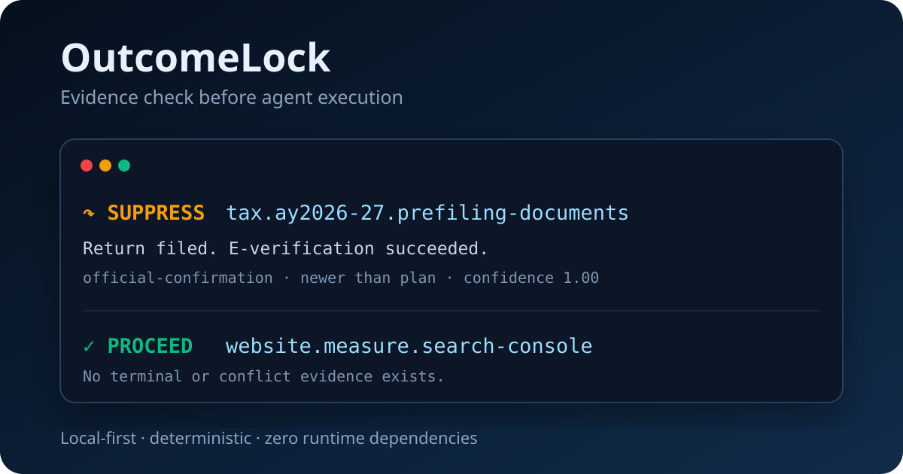

# OutcomeLock

<p align="center">
  <strong>Stop autonomous agents from redoing work that is already complete.</strong>
</p>

<p align="center">
  <a href="https://github.com/godhiraj-code/outcomelock/actions/workflows/test.yml"></a>
  
  
  
</p>



Your agent planned an action. Then the user finished it elsewhere, an email confirmed it, or a canonical tracker changed. The old plan is still queued.

OutcomeLock puts a deterministic evidence check between **plan** and **act**:

```text
[SKIP] SUPPRESS tax.ay2026-27.prefiling-documents
  Work is superseded; evidence is newer than the plan.
  evidence: official-confirmation | email:itr-everification-success

[OK] PROCEED  website.measure.search-console
  No completion or conflict evidence exists.
```

No LLM judge. No cloud account. No probabilistic memory lookup.

## Why this exists

Agent memory and agent execution state are different systems. A memory backend can correctly recall that work was completed while a stale queue still executes the old task.

OutcomeLock protects that boundary with four rules:

1. Every logical outcome has a stable `work_key`.
2. Completion evidence is stored with source, locator, timestamp, confidence, and content hash.
3. Terminal assertions are monotonic. The same work key cannot silently reopen.
4. Ambiguous, contradictory, or weak evidence fails closed.

## 30-second demo

```bash
pip install "outcomelock @ git+https://github.com/godhiraj-code/outcomelock.git"
outcomelock demo
```

Open `outcomelock-demo/report.html`. The demo also emits reusable `evidence.json`, `plan.json`, and `state.db` files.

Replay the generated JSON from any directory:

```bash
outcomelock import outcomelock-demo/evidence.json --db outcomelock-demo/imported.db
outcomelock guard outcomelock-demo/plan.json \
  --db outcomelock-demo/imported.db \
  --report outcomelock-report.html
```

OutcomeLock returns a non-zero exit code because the generated plan contains stale work.

### Coding-agent example

A coding agent queues a production deployment after GitHub Actions already completed it:

```bash
outcomelock import examples/deployment-evidence.json --db deployment.db
outcomelock guard examples/deployment-plan.json --db deployment.db
```

OutcomeLock suppresses `release.v1.4.0.deploy.production` while allowing the new `release.v1.4.1.build` outcome. This is the intended planner-to-executor hook: only exit code `0` may reach the executor.

## CLI

### Record evidence

```bash
outcomelock assert tax.ay2026-27.prefiling-documents \
  --verdict superseded \
  --source official-confirmation \
  --locator email:itr-everification-success \
  --summary "Return submitted and e-verification succeeded" \
  --observed-at 2026-07-19T12:00:00Z
```

### Check before one action

```bash
outcomelock check tax.ay2026-27.prefiling-documents \
  --planned-at 2026-07-19T09:00:00Z
```

### Guard a complete plan

```bash
outcomelock guard plan.json --report report.html
```

### Import evidence in CI

```bash
outcomelock import evidence.json
outcomelock guard plan.json
```

`init`, `assert`, and `import` may create a store. Safety reads (`check`, `guard`, `history`, and `status`) require an existing initialized store. A missing or mistyped database path returns exit code `1` without creating a file; it never means “no evidence, proceed.”

## Decisions and exit codes

| Decision | Meaning | Exit code |
|---|---|---:|
| `proceed` | No completion or conflict evidence exists | `0` |
| `suppress` | Strong evidence says the outcome is complete or obsolete | `2` |
| `blocked` | Evidence is ambiguous, contradictory, or below confidence policy | `3` |
| input error | Invalid JSON, work key, timestamp, or schema | `1` |

If a plan contains both suppressed and blocked actions, `blocked` wins.

## Plan format

```json
{
  "schema_version": "1.0",
  "actions": [
    {
      "id": "task-42",
      "work_key": "learning.module0.cpu.usable",
      "title": "Repeat CPU assessment",
      "planned_at": "2026-07-19T09:00:00Z"
    }
  ]
}
```

See [`schemas/plan.schema.json`](schemas/plan.schema.json) and [`schemas/evidence.schema.json`](schemas/evidence.schema.json).

## GitHub Action

```yaml
- uses: godhiraj-code/outcomelock@v0
  with:
    plan: agent-plan.json
    evidence: completion-evidence.json

- name: Preserve the reconciliation report
  if: always()
  uses: actions/upload-artifact@v4
  with:
    name: outcomelock-report
    path: outcomelock-report.html
```

The action imports evidence atomically, writes `outcomelock-report.html`, and fails when the plan is stale or unresolved. Inputs are passed through environment variables rather than interpolated into shell commands.

## Python API

```python
from outcomelock import EvidenceStore, evaluate

store = EvidenceStore(".outcomelock/state.db")
store.require_initialized()
decision = evaluate(
    "tax.ay2026-27.prefiling-documents",
    store.facts("tax.ay2026-27.prefiling-documents"),
    planned_at="2026-07-19T09:00:00Z",
)

if decision.state != "proceed":
    raise RuntimeError(decision.reason)
```

## Evidence policy

OutcomeLock intentionally does not decide whether an email, tracker, database row, or user statement is trustworthy. Your adapter records that assertion and provenance. OutcomeLock deterministically applies your confidence threshold and conflict policy.

A newer `ambiguous` assertion blocks an older completion. Equal-timestamp contradictory verdicts also block. Timestamps are normalized to UTC while preserving microseconds, so distinct observations within one second retain their order. Evidence identity includes every decision-relevant field; corrected timestamps or confidence values are stored as new observations rather than silently discarded. Reopening requires a new `work_key`, making the changed outcome explicit.

## Use cases

- Long-running autonomous agents
- Personal AI assistants and chief-of-staff systems
- Coding-agent task queues
- Browser and workflow automation
- Scheduled research and operations agents
- Human-in-the-loop approval systems
- CI checks for generated execution plans

## What OutcomeLock is not

- An agent framework
- A vector memory database
- An LLM evaluation platform
- A cloud observability service
- Proof that the underlying real-world task was completed

It solves one narrow problem: **do not act on a plan whose outcome is already satisfied or cannot be safely reconciled.**

## Development

```bash
uv venv
uv pip install -e . --python .venv/Scripts/python.exe
.venv/Scripts/python.exe -m unittest discover -s tests -v
```

On macOS/Linux use `.venv/bin/python`.

## Security and privacy

Evidence stays in local SQLite by default. HTML output escapes untrusted evidence text. Do not put passwords, tokens, tax identifiers, or document contents in summaries or locators. Use opaque source references instead.

See [SECURITY.md](SECURITY.md).

## License

MIT
